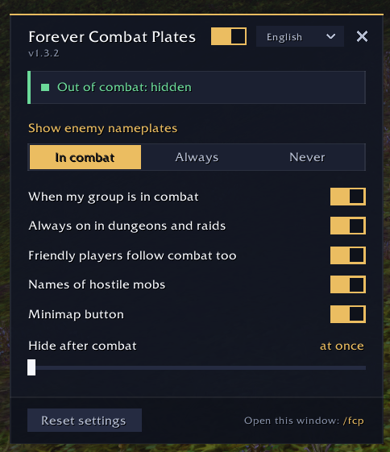

# Forever Combat Plates

Enemy nameplates clutter the screen while you're just running around, and toggling them by hand before every pull gets old fast.

Forever Combat Plates shows enemy nameplates only when the fight starts and hides them a few seconds after it ends. Built for **World of Warcraft: Forever**.

- Turns on the moment you or your group pull
- A short delay after combat, so plates don't blink between pulls
- V still works as a manual toggle out of combat
- No need to set V or Ctrl+V yourself: the addon sets the enemy nameplates (and friendly player ones, when that option is on) again whenever a fight starts or ends, after /reload or login and when you change zones
- Optional: always on in dungeons and raids
- Optional: friendly players follow combat too
- Optional: names over hostile mobs only, never over neutral ones
- Optional: no names over grey mobs, quest mobs always keep theirs
- Your own nameplate settings come back when you turn it off
- 10 languages, minimap button
- Settings: `/fcp`

**Download:** [CurseForge](https://www.curseforge.com/wow/addons/forever-combat-plates) or the [latest GitHub release](https://github.com/sorrow8/forever-combat-plates/releases/latest).

**Install:** unzip the `ForeverCombatPlates` folder into `World of Warcraft/_forever_/Interface/AddOns/`. If the game is already running, type `/reload`.

---

**RU:** индикаторы противников только в бою. Появляются в начале боя и прячутся через пару секунд после. Настройки: `/fcp` или кнопка у миникарты.
